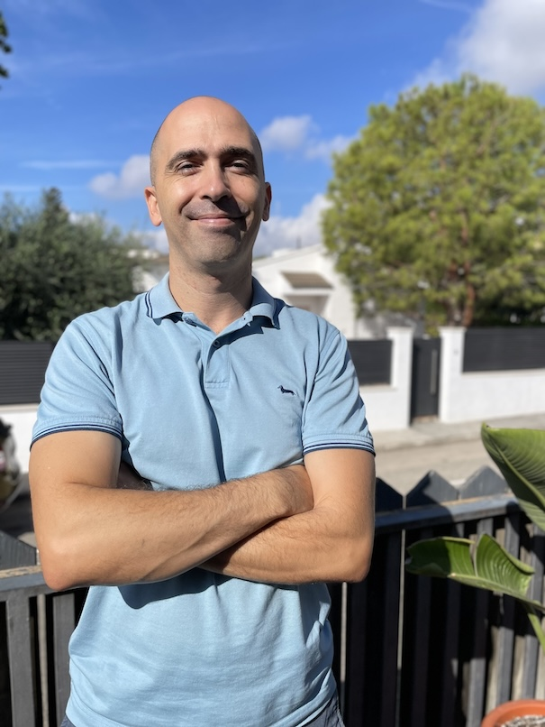

### Hi there 👋

## About me 
Here are some quotes that define my philosophy:

## Projects
Check them out at my portfolio site [www.soldeplata.dev](https://www.soldeplata.dev)

## Articles

I strongly believe that team work is essential to succeed as a developer.

Find my thoughts in my article [Unlocking Developer Teamwork: Proven Strategies for Success](https://dev.to/silverium/a-team-player-approach-416a)
___

<!--
**Silverium/silverium** is a ✨ _special_ ✨ repository because its `README.md` (this file) appears on your GitHub profile.

Here are some ideas to get you started:

- 🔭 I’m currently working on ...
- 🌱 I’m currently learning ...
- 👯 I’m looking to collaborate on ...
- 🤔 I’m looking for help with ...
- 💬 Ask me about ...
- 📫 How to reach me: ...
- 😄 Pronouns: ...
- ⚡ Fun fact: ...
-->